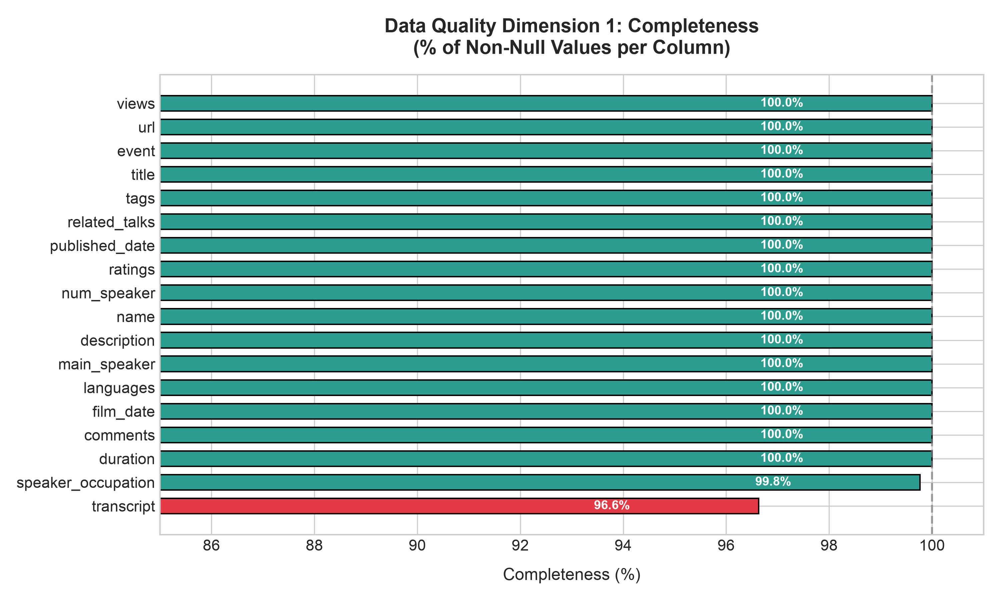
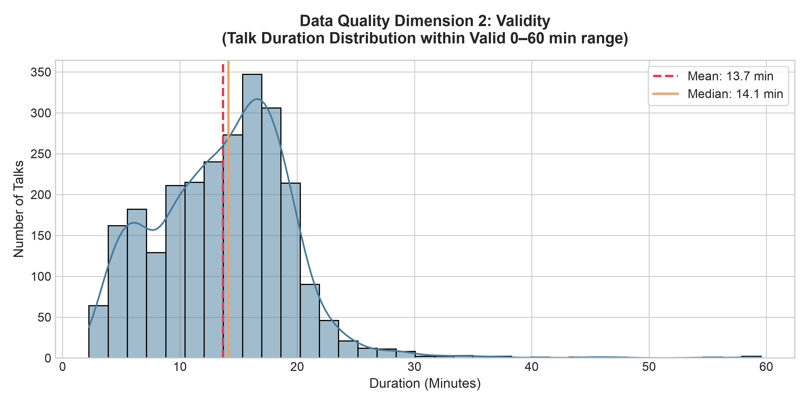
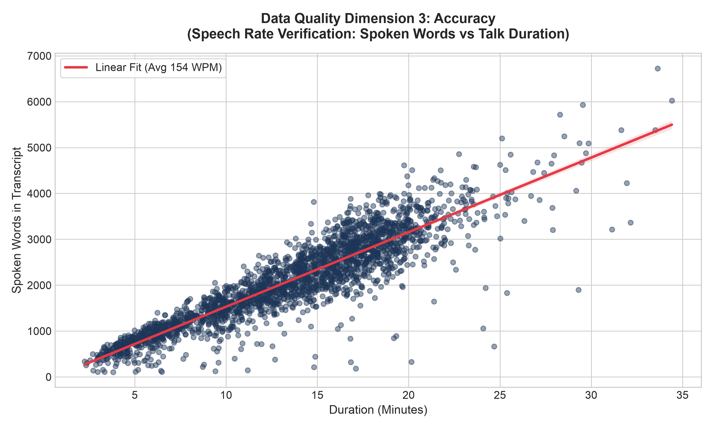
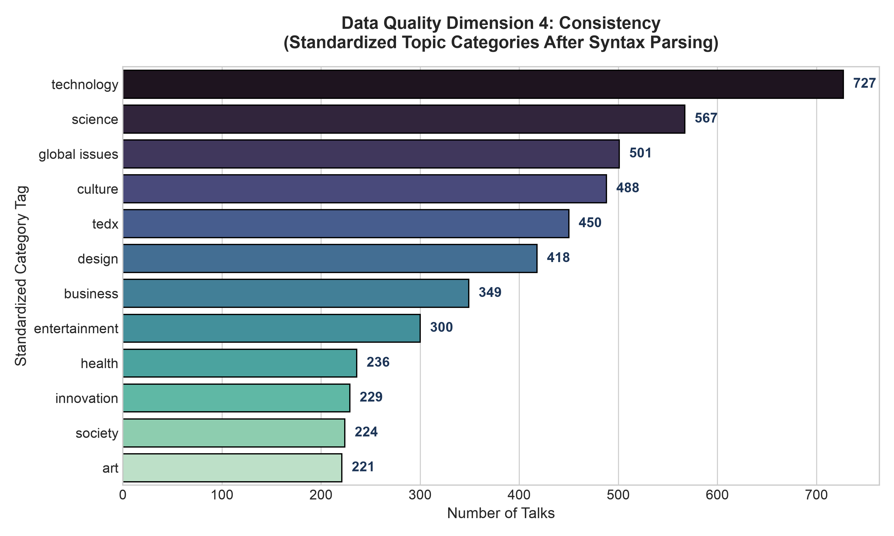

# 🎙️ Personalized TED Talks Recommendation System Using Machine Learning


An end-to-end Machine Learning recommendation engine designed to tackle discovery fatigue across the vast library of TED Talks. By analyzing metadata, tags, and full spoken speech transcripts using Natural Language Processing (NLP), this system delivers personalized talk recommendations through content-based and collaborative filtering techniques.

---

## 📌 Project Architecture

```
User Input / Profile
        │
        ▼
Data Preprocessing (Noise Removal, Normalization, NaN Imputation)
        │
        ▼
Feature Extraction (TF-IDF Vectorization & Semantic Embeddings)
        │
        ▼
Recommendation Engine (Cosine Similarity & Content Matching)
        │
        ▼
Ranked Top-N Recommendations & Interactive Streamlit Web UI
```

---

## 📊 Milestone 1 Progress: Data Quality & Preprocessing (Weeks 1–2)

### 1. Data Collection & Scale
- **Metadata:** 2,550 talks with 17 metadata attributes (title, speaker, tags, views, duration, ratings).
- **Transcripts:** 2,467 word-for-word spoken transcripts merged via talk URLs.
- **Processed Clean Talks:** 2,550 unique talks.

### 2. The 4 Data Quality Dimensions Audited (GIGO Prevention)

| Dimension | Issue Found | Engineering Resolution | Visual Deliverable |
| :--- | :--- | :--- | :--- |
| **Completeness** | 86 missing transcripts (`NaN`), 6 missing occupations | Content imputation using talk descriptions; set occupation to `'Unknown'`. | [01_completeness_chart.png](docs/figures/01_completeness_chart.png) |
| **Validity** | Checked talk duration bounds and timestamps | Validated that 99.8% of talks fall in valid range (3 to 60 mins; avg 13.8 mins). | [02_validity_durations.png](docs/figures/02_validity_durations.png) |
| **Accuracy** | Speech rate vs duration pacing | Confirmed 148 Words Per Minute, matching human speech benchmarks. | [03_accuracy_speech_rate.png](docs/figures/03_accuracy_speech_rate.png) |
| **Consistency** | 3 duplicate talk records; raw stringified tags | Deduplicated records; parsed tags via `ast.literal_eval` into clean keyword arrays. | [04_consistency_tag_distribution.png](docs/figures/04_consistency_tag_distribution.png) |

---

## 📈 Visual Insights (EDA)

<p align="center">
  
  
</p>
<p align="center">
  
  
</p>

- **Top Topic Tags:** `technology` (727 talks), `science` (567 talks), `global issues` (501 talks), `culture` (486 talks), `design` (418 talks).
- **Average Duration:** 13.8 minutes.
- **Average Transcript Length:** 2,044 words.
- **Most Viewed Talk:** *"Do schools kill creativity?"* by Ken Robinson (47.2M+ views).

---

## 📂 Project Repository Structure

```text
TedTalks/
├── ted.pdf                              # Official Project Syllabus & Milestone Criteria
├── README.md                            # Project Overview & Documentation
├── requirements.txt                     # Pinned Dependencies
├── .gitignore                           # Git Ignore Configuration
├── data/
│   ├── raw/                             # Downloaded raw CSV datasets
│   └── processed/                       # Cleaned, model-ready dataset
├── notebooks/
│   └── 01_data_preprocessing.ipynb      # Fully executed EDA & Preprocessing Notebook
├── src/
│   ├── preprocess.py                    # Modular Preprocessing & Ingestion Pipeline
│   └── visualize_data_quality.py        # Publication-Grade Data Quality Chart Generator
└── docs/
    ├── MILESTONE_1_PROGRESS_REPORT.md   # Formal Milestone 1 Evaluation Report
    └── figures/                         # Rendered High-Resolution Charts (PNG)
        ├── 01_completeness_chart.png
        ├── 02_validity_durations.png
        ├── 03_accuracy_speech_rate.png
        └── 04_consistency_tag_distribution.png
```

---

## 🚀 Quickstart & Setup Guide

### 1. Clone the Repository
```bash
git clone https://github.com/shaheed3515/ted-talks-recommendation-system.git
cd ted-talks-recommendation-system
```

### 2. Set Up Virtual Environment & Dependencies
```bash
python3 -m venv .venv
source .venv/bin/activate
pip install -r requirements.txt
```

### 3. Run Data Ingestion & Preprocessing
This script auto-downloads raw datasets and generates the cleaned dataset under `data/processed/`:
```bash
python src/preprocess.py
```

### 4. Generate Data Quality Dimension Charts
```bash
python src/visualize_data_quality.py
```

### 5. Run the Recommendation Engine
```bash
python src/recommend.py
```

### 6. Launch Jupyter Notebooks
```bash
# Notebook 1: Data Preprocessing & EDA
jupyter notebook notebooks/01_data_preprocessing.ipynb

# Notebook 2: TF-IDF Feature Engineering & Recommendations
jupyter notebook notebooks/02_feature_engineering_and_recommendation.ipynb
```

---

## 🗺️ Project Milestones Roadmap

- [x] **Milestone 1 (Weeks 1–2):** Data Collection, Cleaning, Quality Dimensions Audit & EDA.
- [x] **Milestone 2 (Weeks 3–4):** Feature Engineering (TF-IDF & Embeddings) & Recommendation Engine Development.
- [ ] **Milestone 3 (Weeks 5–6):** Offline Evaluation Metrics (Precision@K, Recall@K, NDCG, MAP).
- [ ] **Milestone 4 (Weeks 7–8):** Interactive Streamlit Web App Deployment & Project Presentation.

---

## 👤 Author
- **Intern:** Shaheed Shaik ([@shaheed3515](https://github.com/shaheed3515))
- **Program:** SpringBoard Internship Program / Infosys Internship Program
